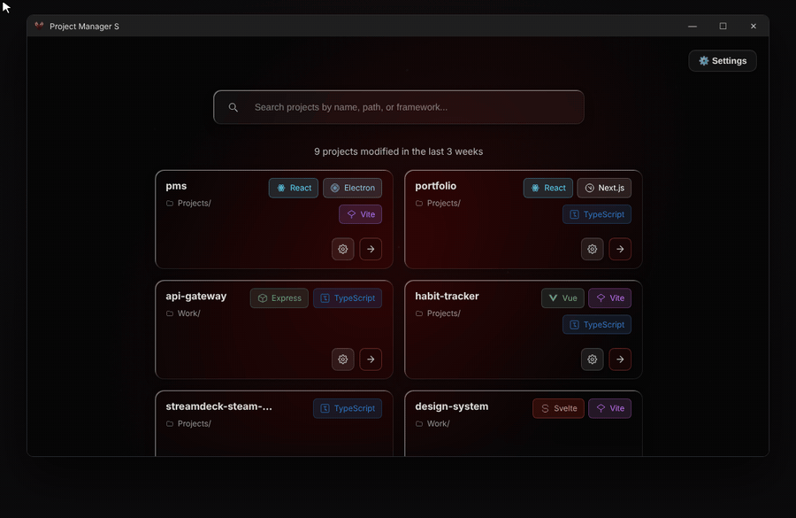

<p align="center">
  
</p>

<h1 align="center">PMS · Project Manager S</h1>

<p align="center">
  <b>Jump back into any project without digging through folders.</b><br/>
  A small Windows app that finds the projects you worked on recently and opens them in VS Code, Cursor or WebStorm in one click.
</p>

<p align="center">
  <a href="https://github.com/SantosMaxime/pms/releases/latest"></a>
  
  
  
  
  <a href="LICENSE"></a>
</p>

<p align="center">
  
</p>

<p align="center">
  <a href="https://github.com/SantosMaxime/pms/releases/latest"><b>Download for Windows</b></a> ·
  <a href="#features">Features</a> ·
  <a href="#getting-started">Getting started</a> ·
  <a href="#development">Development</a>
</p>

---

## Features

- **Recent projects first.** PMS scans the folders you choose and shows the projects you modified in the last 3 weeks, newest first.
- **Instant search.** Filter as you type by name, path or framework. Search covers every project, not only recent ones.
- **Framework badges.** React, Next.js, Vue, Svelte, Angular, Electron, Express and more are read from each project's `package.json`.
- **Open in your editor.** VS Code, Cursor and WebStorm are detected automatically. Click a card, or pick an editor from its menu.
- **Default editor per project.** Choose which editor a card opens with. PMS remembers it between sessions.
- **Always at hand.** Closing the window keeps PMS in the system tray, with your 4 most recent projects one click away. It can also start with Windows.
- **Updates itself.** New versions download in the background. Restart when you're ready, from the app or the tray.

---

## Getting started

1. Download `PMS-Setup.exe` from the [latest release](https://github.com/SantosMaxime/pms/releases/latest) and run it.
2. Open **Settings** (top right) and add the folders that contain your projects, for example `C:\Users\you\Documents\GitHub`. Each sub-folder is treated as a project.
3. That's it. Your recent projects appear on the home screen.

If an editor is installed in an unusual location, set its path under **Settings → Editor Paths**.

---

## Development

Requires Node.js 18+.

```bash
git clone https://github.com/SantosMaxime/pms.git
cd pms
npm install
npm run dev          # run the app with hot reload
npm run build:win    # build the Windows installer (dist/PMS-Setup.exe)
```

<details>
<summary><b>All scripts</b></summary>

| Script | Description |
|--------|-------------|
| `npm run dev` | Start the app in development mode |
| `npm run build` | Type-check and bundle main, preload and renderer |
| `npm run build:win` | Build the Windows NSIS installer |
| `npm run build:mac` / `build:linux` | Build for macOS / Linux (untested) |
| `npm run lint` | Run ESLint |
| `npm run typecheck` | Type-check the Node and web projects |
| `npm run format` | Format with Prettier |

</details>

<details>
<summary><b>Releasing a new version</b></summary>

1. Bump `version` in `package.json` (for example `1.2.0`) and merge it into `main`.
2. Push a matching tag:

   ```bash
   git tag v1.2.0
   git push origin v1.2.0
   ```

   Or run **Actions → Release → Run workflow** on `main` with **publish** ticked, which creates the tag for you.

3. The **Release** workflow builds the Windows installer and publishes it as a GitHub Release, along with `latest.yml`. Installed copies of PMS find it within a few hours, or right away with **Settings → Check for updates**.

</details>

<details>
<summary><b>Project structure</b></summary>

```
pms/
├── src/
│   ├── main/          # Electron main process: file system, tray, editor launch, updater
│   ├── preload/       # Typed bridge exposed to the renderer as window.api
│   └── renderer/      # React UI (search, project cards, settings)
├── .github/workflows/ # Builds and publishes the Windows installer
├── build/             # Installer resources (icons, NSIS script)
├── resources/         # App icons
├── scripts/demo/      # Records docs/demo.gif
└── docs/              # README assets
```

</details>

<details>
<summary><b>Regenerating the demo GIF</b></summary>

`docs/demo.gif` is recorded from the real React UI, with the Electron API replaced by fictional projects. It requires Playwright (Chromium) and ffmpeg:

```bash
node scripts/demo/render-demo.mjs
```

</details>

**Tech stack:** Electron 38, React 19, TypeScript, Vite (electron-vite), electron-builder.

---

## Contributing

Issues and pull requests are welcome.

## License

MIT © Santos Maxime. See [LICENSE](LICENSE).
